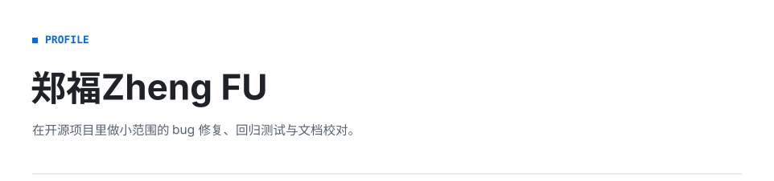
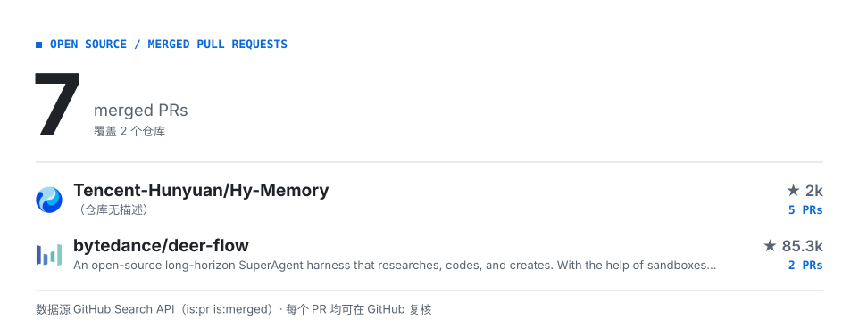

  

<!-- CONTRIB:BEGIN -->

  

<!-- CONTRIB:END -->

做的是 Agent 运行时那一层：网关与代理、密钥读取、检索元数据。只提交能复现的问题，每个都带回归用例。

**bytedance/deer-flow** · 85.5k stars

- [#7877](https://github.com/bytedance/deer-flow/pull/7877) 环回 Gateway 的调用不再被 `HTTP_PROXY` 劫持：把 `trust_env` 判定抽成无依赖模块，并为环回与私网地址自建 `httpx` 客户端，保留原 SDK 的重试、超时与 `User-Agent`
- [#8048](https://github.com/bytedance/deer-flow/pull/8048) 补齐 goal-objective 与 bash 退出码解析的边界用例，防止异常路径被改回静默吞错

**Tencent-Hunyuan/Hy-Memory** · 2.1k stars

- [#382](https://github.com/Tencent-Hunyuan/Hy-Memory/pull/382) 打包 Linux Secret Service keyring 后端
- [#411](https://github.com/Tencent-Hunyuan/Hy-Memory/pull/411) D-Bus keyring 读取加超时上限，避免无桌面环境下 `sdk-migrate` 永久挂起
- [#311](https://github.com/Tencent-Hunyuan/Hy-Memory/pull/311) 修复 chroma 元数据 `tag_ners` 未解码导致的读写往返失真
- [#383](https://github.com/Tencent-Hunyuan/Hy-Memory/pull/383) 向 SDK 检索透传可配置的 `min_score`
- [#313](https://github.com/Tencent-Hunyuan/Hy-Memory/pull/313) 把 `data/` 忽略规则锚定到仓库根

数量来自 GitHub Search API（<code>is:pr is:merged</code>），每个 PR 都可点进去复核。
